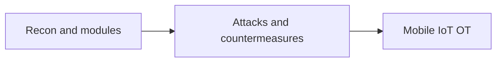

# IA 445 - Ethical Hacking and Offensive Security

College coursework archive for **IA 445 - Ethical Hacking and Offensive Security** at Eastern Michigan University.  
Module write-ups, Earth lab series, and offensive security lab reports from Canvas.

**Author:** [Julio Barros](https://github.com/Jkbarros)  
**Index:** [college-projects](https://github.com/Jkbarros/college-projects)

## What is in this repository

| Area | Description |
|------|-------------|
| [Archive index](docs/archive-index.md) | Catalog of files in `archive/` with direct links |
| [`archive/canvas-submissions/`](archive/canvas-submissions/) | Modules, labs (mobile/IoT/OT), Earth project PDFs/DOCX |

### Highlights

- Module 01-11 coursework and lab PDFs
- Labs on mobile, IoT, and OT attack surfaces
- IA 445 Earth project submissions

## Topics covered

## Related repos

| Course | Link |
|--------|------|
| IA 103 - Information Security Overview | [information-security-overview](https://github.com/Jkbarros/information-security-overview) |
| college-projects index | [college-projects](https://github.com/Jkbarros/college-projects) |

## Roadmap

- [ ] Convert key submissions to markdown in `docs/` (same pattern as IA 103)
- [ ] Redact any sensitive identifiers before expanding public docs

## Notes for readers

- This repo documents **my submitted work** for academic context only.
- EMU or publisher course materials are not redistributed beyond my own submissions in `archive/`.

## License

Content © Julio Barros. Use at your own risk.
