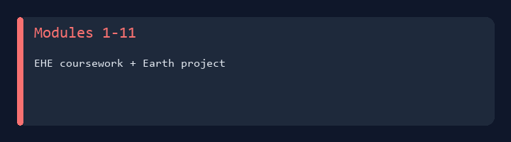
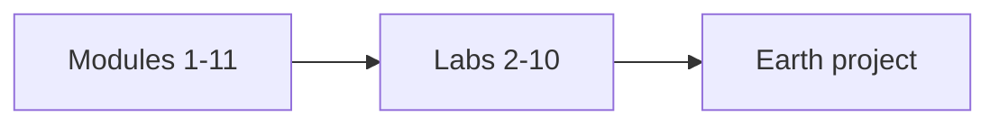

# IA 445 - Ethical Hacking and Offensive Security



College coursework portfolio for **IA 445** at Eastern Michigan University.  
**Ethical Hacking Essentials** modules, **labs 02–10** (including **mobile**, **IoT**, and **OT**), the **Earth** project, and VirtualBox lab tooling.

**Author:** [Julio Barros](https://github.com/Jkbarros)  
**Index:** [college-projects](https://github.com/Jkbarros/college-projects)

## What is in this repository

| Area | Description |
|------|-------------|
| [Submissions catalog](docs/submissions-catalog.md) | Full map of modules, labs, Earth project |
| [Earth project](docs/ia-445-earth.md) | Primary DOCX + [PDF export](docs/ia-445-earth-pdf.md) |
| [Lab 09 — Mobile](docs/lab-09-mobile-attacks-and-countermeasures.md) | Mobile attacks and countermeasures |
| [Lab 10 — IoT/OT](docs/lab-10-iot-and-ot-attacks-and-countermeasures.md) | IoT and OT attacks and countermeasures |
| [GetVMinfo script](docs/getvminfo-script.md) | VirtualBox inventory batch helper |
| [Archive index](docs/archive-index.md) | All original Canvas files |
| [`archive/canvas-submissions/`](archive/canvas-submissions/) | DOCX, PDF, and `.txt` exports |

### Highlights

- **12 DOCX** and **12 PDF** submissions converted to markdown under `docs/`
- PDF pages with graphics include extracted screenshots in `docs/screenshots/`
- Course arc: modules → hands-on labs → capstone-style Earth documentation

## Topics covered



## Regenerate docs

```bash
pip install -r requirements.txt
python scripts/docx_to_markdown.py
python scripts/build_pdf_docs.py
python scripts/generate_readme_demo.py
```

## Related repos

| Course | Link |
|--------|------|
| IA 403 - Malware Analysis | [ia403-malware-analysis-reverse-engineering](https://github.com/Jkbarros/ia403-malware-analysis-reverse-engineering) |
| IA 447 - Digital Forensics I | [ia447-digital-forensics-i](https://github.com/Jkbarros/ia447-digital-forensics-i) |
| college-projects index | [college-projects](https://github.com/Jkbarros/college-projects) |

## Notes for readers

- Educational offensive-security coursework only; use techniques only on systems you are authorized to test.
- EMU or publisher materials are not redistributed beyond my submissions in `archive/`.

## License

Content © Julio Barros. Use at your own risk.
