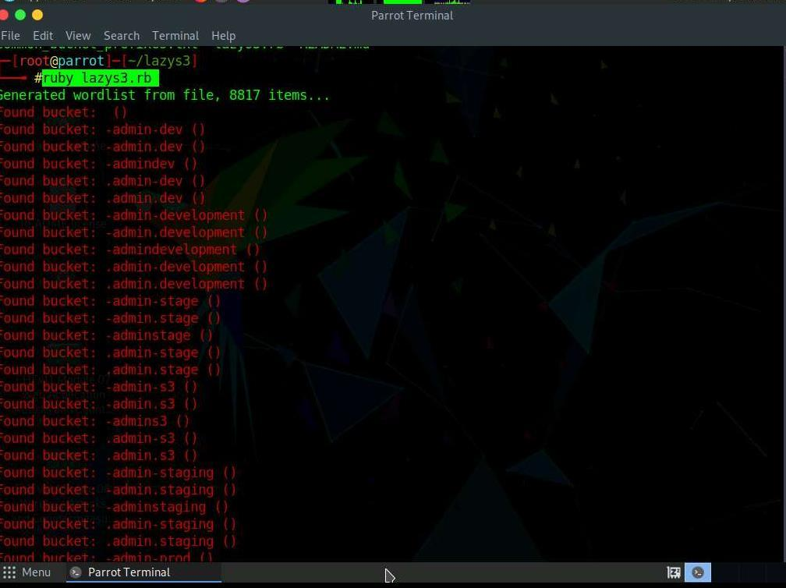
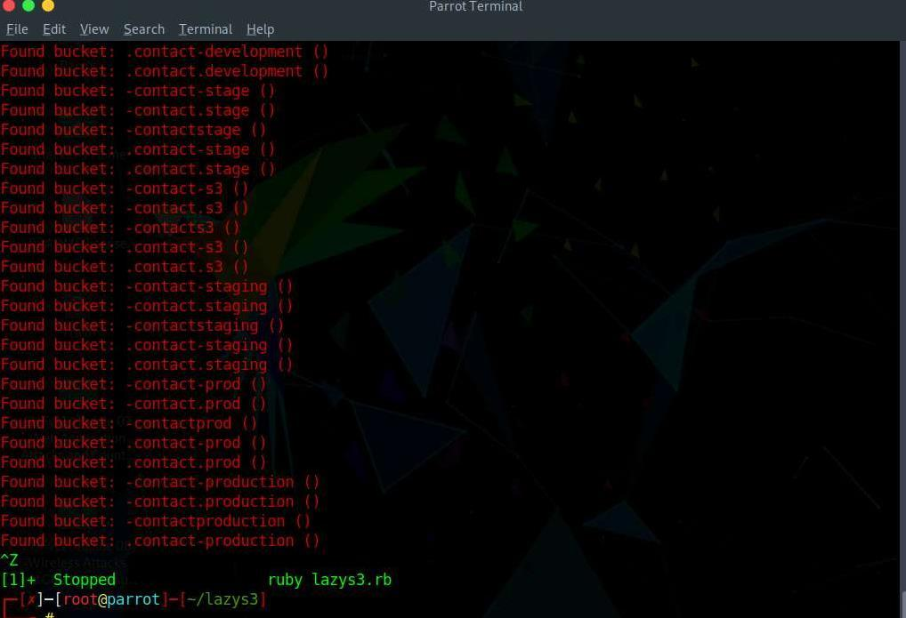
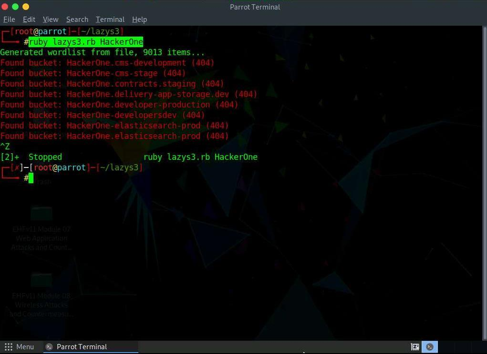
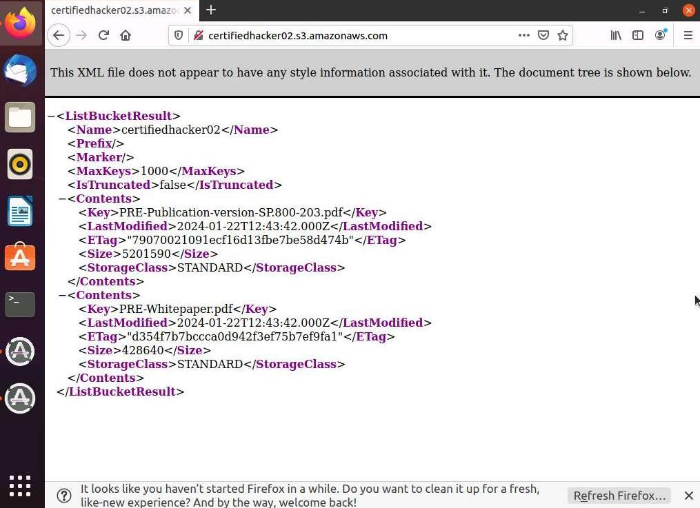
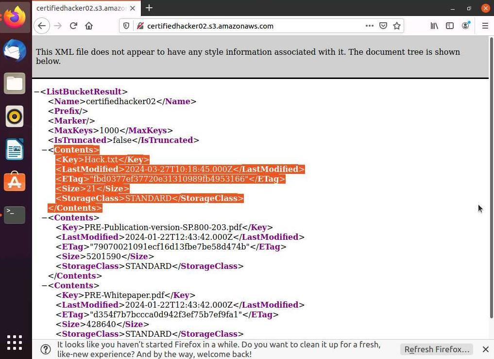

# EHEv1, Module 11

**Source:** [`EHEv1, Module 11.pdf`](../archive/canvas-submissions/EHEv1,%20Module%2011.pdf)  
**Course:** IA 445 - Ethical Hacking and Offensive Security (EMU)  
**Author:** Julio Barros

## Page 1

What are the defaults for an S# bucket?

## Page 2

Provide a screenshot of your enumeration results.

## Page 3

Provide a screenshot of your AWS CLI exploit attempts.

## Page 4

## Page 5

Then provide short answers, in your own words. 
Two or five concise sentences that explain your answers. 
1) What worked well in the lab? 
The integration with AWS I thought would be a problem but surprisingly was 
smooth. 
2) What parts were troublesome? 
Generation the AWS Access Key and importing to ubuntu 
3) Over all impression of the lab? 
It was a good lab since I had to do it to a different class as well.

