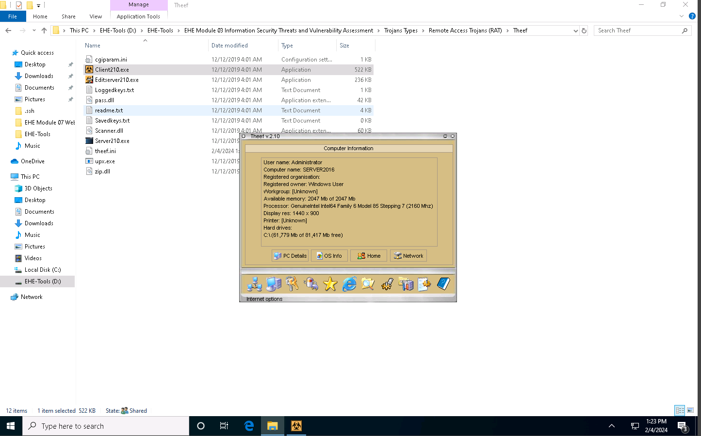
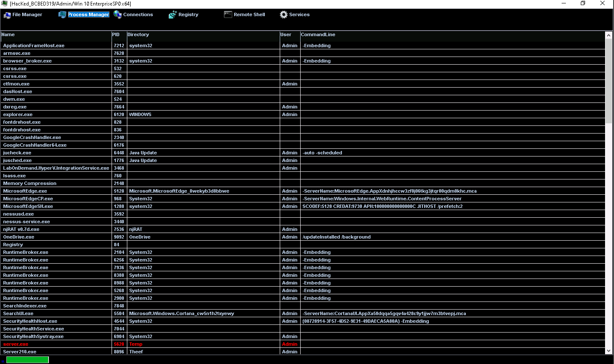
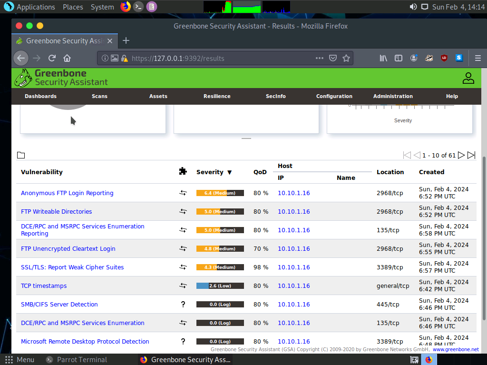

# Lab 03 info

**Source:** [`Lab 03 info.pdf`](../archive/canvas-submissions/Lab%2003%20info.pdf)  
**Course:** IA 445 - Ethical Hacking and Offensive Security (EMU)  
**Author:** Julio Barros

## Page 1

## Page 2

## Page 3

1) What worked well in the lab? 
The lab was delayed a little bit but, after few refreshers started worked properly. 
2) What parts were troublesome? 
In this lab, I had no problems; all the steps were clear and smooth. The only issue I 
encountered was with one of the passwords on the parrot machine due to the caps being 
inverted. 
3) Over all impression of the lab? 
I really like this lab. Creating the virus part was fun; I spent more time on that part 
because I tried to create different types of viruses and explore various 
possibilities.
